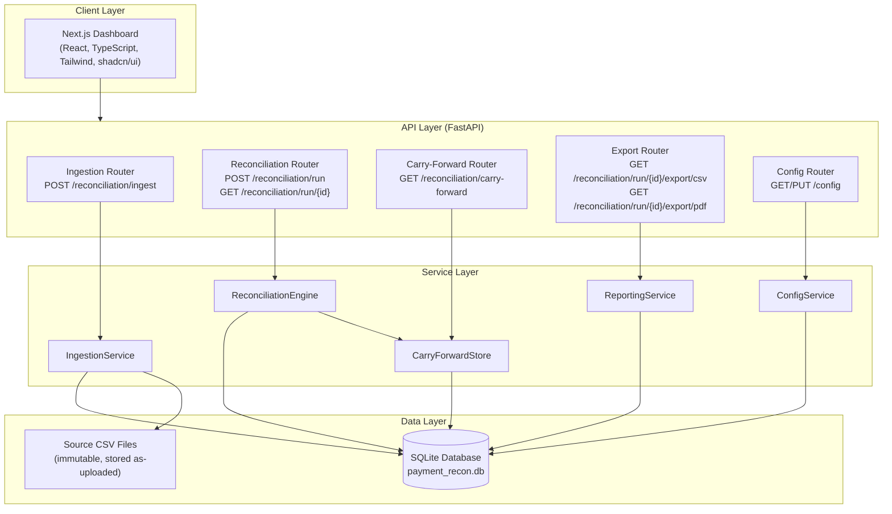
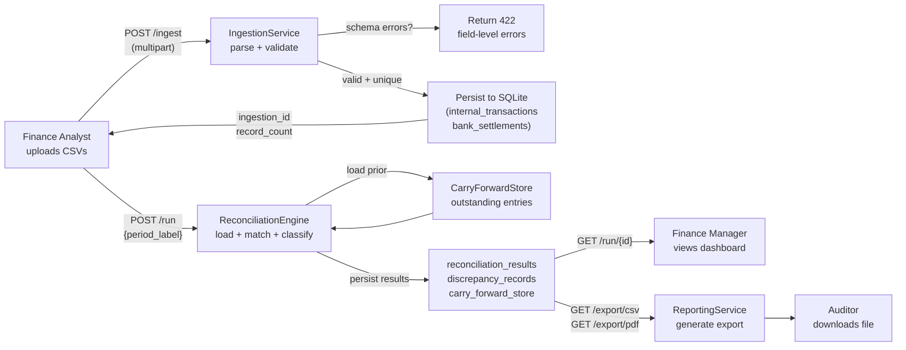
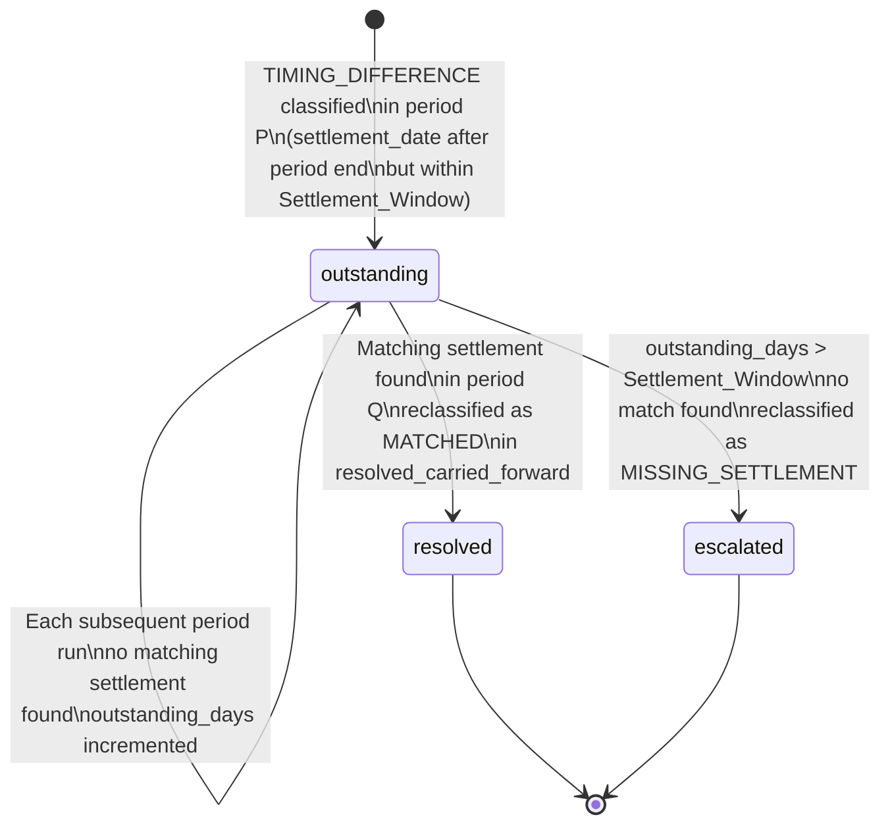

# Design Document — Payment Reconciliation & Discrepancy Detection System

## Overview

This document describes the technical design for the Payment Reconciliation & Discrepancy Detection System. The system ingests internal payment transaction records and bank settlement records, executes a deterministic reconciliation algorithm that classifies every record into one of twelve named discrepancy types, tracks cross-period carry-forward items, computes six precisely defined financial totals, and surfaces results through a RESTful API and a Next.js dashboard. All monetary arithmetic uses `decimal.Decimal` throughout — from CSV parse through SQLite storage through JSON serialization — with no floating-point at any boundary.

---

## Architecture

### Overall System Architecture



### Data Flow



---

## Components and Interfaces

### Backend Component Map

| Component | Responsibility | Key Dependencies |
|---|---|---|
| `IngestionService` | Parse CSVs, validate schemas, persist source records, detect duplicate ingestions | Pydantic models, `decimal.Decimal`, SQLite |
| `ReconciliationEngine` | Load data, run matching algorithm, classify all records, compute financial totals, trigger carry-forward updates | `IngestionService` data, `CarryForwardStore`, `ConfigService` |
| `CarryForwardStore` | Persist TIMING_DIFFERENCE entries, update statuses, log all transitions with timestamps | SQLite `carry_forward_entries` table |
| `ReportingService` | Generate CSV and PDF exports from completed Reconciliation_Results | `csv` module, `reportlab` (PDF), SQLite |
| `ConfigService` | Persist and retrieve `Rounding_Tolerance`, `Settlement_Window`, `supported_currencies` | SQLite `config` table |
| `DuplicateDetector` | Identify DUPLICATE_TRANSACTION and DUPLICATE_SETTLEMENT per Rules D-01–D-04 | Called by `ReconciliationEngine` as a pre-processing step |
| `FinancialCalculator` | Compute all six financial totals using `decimal.Decimal` | Called at end of reconciliation run |

### Frontend Component Map

| Component | Responsibility |
|---|---|
| `DashboardPage` | Root page; fetches latest run summary and renders summary cards |
| `RunSelector` | Dropdown to choose any prior completed run |
| `SummaryCard` | Displays Reconciliation_Variance, Outstanding_Amount, aggregate rounding fields |
| `DiscrepancyTable` | Grouped breakdown table: classification → count + total amount |
| `RoundingAlertBanner` | Conditionally rendered warning when `aggregate_exceeds_tolerance = true` |
| `CarryForwardPanel` | Table of outstanding items by originating period with outstanding_days |
| `RecordDrilldown` | Modal showing duplicate_fingerprint evidence for DUPLICATE_* records |
| `ExportButtons` | CSV and PDF export triggers for the selected run |
| `RunStatusPoller` | Polls `GET /run/{id}/status` every 5 seconds while run is in progress |
| `IngestForm` | File upload form for internal transactions and bank settlements CSVs |
| `ConfigPanel` | Form to view and update Rounding_Tolerance, Settlement_Window, supported_currencies |

---

## Backend Architecture

### FastAPI Application Structure

```
app/
├── main.py                    # FastAPI app factory, router registration
├── config.py                  # App settings (db path, defaults)
├── database.py                # SQLite connection management
├── routers/
│   ├── ingestion.py           # POST /reconciliation/ingest
│   ├── reconciliation.py      # POST /run, GET /run/{id}, GET /run/{id}/status
│   ├── carry_forward.py       # GET /reconciliation/carry-forward
│   ├── export.py              # GET /run/{id}/export/csv, /export/pdf
│   └── configuration.py      # GET/PUT /config
├── services/
│   ├── ingestion_service.py
│   ├── reconciliation_engine.py
│   ├── carry_forward_store.py
│   ├── duplicate_detector.py
│   ├── financial_calculator.py
│   ├── reporting_service.py
│   └── config_service.py
├── models/
│   ├── domain.py              # Pydantic domain models (InternalTransaction, BankSettlement, etc.)
│   ├── db.py                  # SQLAlchemy/sqlite3 row mappings
│   └── api.py                 # Request/response Pydantic models
├── utils/
│   ├── decimal_utils.py       # Decimal parsing, formatting, ROUND_HALF_UP display
│   └── hash_utils.py          # File hash computation for duplicate ingestion detection
└── tests/
    ├── unit/
    ├── integration/
    └── property/
```

### Service Layer Design

Each service is a plain Python class instantiated once (via FastAPI dependency injection). Services do not share mutable state; all state lives in SQLite. The `ReconciliationEngine` is the orchestrator — it calls `DuplicateDetector`, `CarryForwardStore`, and `FinancialCalculator` in sequence.

---

## Frontend Architecture

### Next.js Application Structure

```
frontend/
├── app/
│   ├── layout.tsx             # Root layout, global nav
│   ├── page.tsx               # Redirect to /dashboard
│   ├── dashboard/
│   │   └── page.tsx           # DashboardPage
│   ├── ingest/
│   │   └── page.tsx           # IngestForm page
│   └── config/
│       └── page.tsx           # ConfigPanel page
├── components/
│   ├── ui/                    # shadcn/ui primitives (re-exported)
│   ├── SummaryCard.tsx
│   ├── DiscrepancyTable.tsx
│   ├── RoundingAlertBanner.tsx
│   ├── CarryForwardPanel.tsx
│   ├── RecordDrilldown.tsx
│   ├── ExportButtons.tsx
│   ├── RunSelector.tsx
│   ├── RunStatusPoller.tsx
│   └── IngestForm.tsx
├── lib/
│   ├── api.ts                 # Typed fetch wrappers for all endpoints
│   └── formatters.ts          # Amount display (never use JS Number for amounts)
└── types/
    └── reconciliation.ts      # TypeScript interfaces mirroring API response shapes
```

### Amount Handling in Frontend

All monetary amounts arrive from the API as strings. The frontend **never** parses them into JavaScript `number`. Display uses string formatting only: amounts are split at the decimal point and rendered as `{integer}.{fractional} {currency}`. Arithmetic is never performed in the frontend — all computed values come from the API.

---

## Data Models

### Domain Pydantic Models

```python
from decimal import Decimal
from datetime import date, datetime
from typing import Literal, Optional
from pydantic import BaseModel, field_validator
import uuid

class InternalTransaction(BaseModel):
    transaction_id: str                        # UUID
    transaction_ref: str
    transaction_date: date
    transaction_amount: Decimal                # Always Decimal, never float
    currency: str                              # ISO 4217
    transaction_type: Literal["payment", "refund"]
    status: Literal["success", "pending", "failed"]
    original_transaction_id: Optional[str] = None
    merchant_id: str
    payment_method: str

    @field_validator("transaction_amount", mode="before")
    @classmethod
    def parse_decimal(cls, v):
        # Reject floats; accept only str or Decimal
        if isinstance(v, float):
            raise ValueError("transaction_amount must be a string decimal, not float")
        return Decimal(str(v))


class BankSettlement(BaseModel):
    settlement_id: str
    transaction_ref: str
    settlement_amount: Decimal
    currency: str
    settlement_date: date
    settlement_timestamp: datetime
    bank_batch_id: str
    bank_name: str
    status: Literal["settled", "reversed", "pending"]

    @field_validator("settlement_amount", mode="before")
    @classmethod
    def parse_decimal(cls, v):
        if isinstance(v, float):
            raise ValueError("settlement_amount must be a string decimal, not float")
        d = Decimal(str(v))
        if d < 0:
            raise ValueError("settlement_amount must be non-negative")
        return d


ClassificationEnum = Literal[
    "MATCHED", "TIMING_DIFFERENCE", "MISSING_SETTLEMENT", "UNMATCHED_SETTLEMENT",
    "PARTIAL_SETTLEMENT", "MULTIPLE_SETTLEMENTS", "AMOUNT_MISMATCH",
    "ROUNDING_DIFFERENCE", "CURRENCY_MISMATCH", "DUPLICATE_TRANSACTION",
    "DUPLICATE_SETTLEMENT", "ORPHAN_REFUND",
]


class DiscrepancyRecord(BaseModel):
    record_id: str                             # UUID
    transaction_id: Optional[str]
    settlement_id: Optional[str]
    classification: ClassificationEnum
    transaction_amount: Optional[Decimal]
    settlement_amount: Optional[Decimal]
    individual_difference: Optional[Decimal]
    currency: str
    period_label: str
    rule_id: str
    duplicate_fingerprint: Optional[str] = None
    resolution_note: Optional[str] = None


class ReconciliationResult(BaseModel):
    run_id: str
    period_label: str
    run_status: Literal["pending", "running", "completed", "failed"]
    run_timestamp: datetime
    configuration_snapshot: dict               # {rounding_tolerance: str, settlement_window: int}
    gross_transaction_value: Decimal
    refund_total: Decimal
    net_transaction_value: Decimal
    bank_settlement_total: Decimal
    outstanding_amount: Decimal
    reconciliation_variance: Decimal
    aggregate_rounding_difference: Decimal
    aggregate_exceeds_tolerance: bool
    discrepancy_list: list[DiscrepancyRecord]
    resolved_carried_forward: list[dict]
    error_detail: Optional[str] = None


class CarryForwardEntry(BaseModel):
    entry_id: str
    transaction_id: str
    originating_period_label: str
    resolved_period_label: Optional[str] = None
    outstanding_days: int
    status: Literal["outstanding", "resolved", "escalated"]
    created_at: datetime
    created_as_of_date: date                   # explicit cutoff when entry was created; used for deterministic day counts
    last_updated_at: datetime
    reconciliation_run_id: str                 # Run that last updated this entry


class SystemConfig(BaseModel):
    rounding_tolerance: Decimal                # Default Decimal("0.01")
    settlement_window: int                     # Default 2 (days)
    supported_currencies: list[str]            # Default ["INR", "USD", "EUR"]
```

### JSON Serialization Rules

All Pydantic models that contain `Decimal` fields use a custom JSON encoder that serializes `Decimal` values as strings:

```python
# In decimal_utils.py
from decimal import Decimal, ROUND_HALF_UP

def decimal_to_str(value: Decimal) -> str:
    """Serialize Decimal as string for JSON output. Full precision, no rounding."""
    return str(value)

def decimal_for_display(value: Decimal, places: int = 2) -> str:
    """ROUND_HALF_UP to specified decimal places for display/export only."""
    quantize_str = Decimal("0." + "0" * places)
    return str(value.quantize(quantize_str, rounding=ROUND_HALF_UP))

def parse_decimal_str(s: str) -> Decimal:
    """Parse a string to Decimal. Raises ValueError if not parseable."""
    try:
        return Decimal(s)
    except Exception:
        raise ValueError(f"Cannot parse '{s}' as Decimal")
```

---

## Database Design

### SQLite Schema

```sql
-- System configuration (single row, keyed by id=1)
CREATE TABLE config (
    id                  INTEGER PRIMARY KEY CHECK (id = 1),
    rounding_tolerance  TEXT NOT NULL DEFAULT '0.01',   -- Decimal as TEXT
    settlement_window   INTEGER NOT NULL DEFAULT 2,
    supported_currencies TEXT NOT NULL DEFAULT '["INR","USD","EUR"]',  -- JSON array
    updated_at          TEXT NOT NULL
);

-- Source internal transactions (immutable after ingestion)
CREATE TABLE internal_transactions (
    id                      INTEGER PRIMARY KEY AUTOINCREMENT,
    ingestion_id            TEXT NOT NULL,
    transaction_id          TEXT NOT NULL,
    transaction_ref         TEXT NOT NULL,
    transaction_date        TEXT NOT NULL,          -- ISO 8601 date string
    transaction_amount      TEXT NOT NULL,          -- Decimal as TEXT, never REAL
    currency                TEXT NOT NULL,
    transaction_type        TEXT NOT NULL,
    status                  TEXT NOT NULL,
    original_transaction_id TEXT,
    merchant_id             TEXT NOT NULL,
    payment_method          TEXT NOT NULL,
    period_label            TEXT NOT NULL,
    created_at              TEXT NOT NULL
);

CREATE INDEX idx_it_transaction_ref ON internal_transactions(transaction_ref);
CREATE INDEX idx_it_transaction_id  ON internal_transactions(transaction_id);
CREATE INDEX idx_it_period_label    ON internal_transactions(period_label);
CREATE INDEX idx_it_ingestion_id    ON internal_transactions(ingestion_id);

-- Source bank settlements (immutable after ingestion)
CREATE TABLE bank_settlements (
    id                   INTEGER PRIMARY KEY AUTOINCREMENT,
    ingestion_id         TEXT NOT NULL,
    settlement_id        TEXT NOT NULL,
    transaction_ref      TEXT NOT NULL,
    settlement_amount    TEXT NOT NULL,            -- Decimal as TEXT
    currency             TEXT NOT NULL,
    settlement_date      TEXT NOT NULL,
    settlement_timestamp TEXT NOT NULL,
    bank_batch_id        TEXT NOT NULL,
    bank_name            TEXT NOT NULL,
    status               TEXT NOT NULL,
    period_label         TEXT NOT NULL,
    created_at           TEXT NOT NULL
);

CREATE INDEX idx_bs_transaction_ref  ON bank_settlements(transaction_ref);
CREATE INDEX idx_bs_settlement_id    ON bank_settlements(settlement_id);
CREATE INDEX idx_bs_period_label     ON bank_settlements(period_label);

-- Ingestion records (audit trail for every file upload)
CREATE TABLE ingestion_records (
    ingestion_id    TEXT PRIMARY KEY,
    file_hash       TEXT NOT NULL,
    period_label    TEXT NOT NULL,
    record_count    INTEGER NOT NULL,
    file_type       TEXT NOT NULL,                 -- 'internal_transactions' or 'bank_settlements'
    ingested_at     TEXT NOT NULL,
    UNIQUE (file_hash, period_label, file_type)
);

-- Reconciliation run headers
CREATE TABLE reconciliation_runs (
    run_id                      TEXT PRIMARY KEY,
    period_label                TEXT NOT NULL,
    run_status                  TEXT NOT NULL,     -- pending, running, completed, failed
    run_timestamp               TEXT NOT NULL,
    configuration_snapshot      TEXT NOT NULL,     -- JSON: {rounding_tolerance, settlement_window}
    gross_transaction_value     TEXT,              -- Decimal as TEXT; NULL until completed
    refund_total                TEXT,
    net_transaction_value       TEXT,
    bank_settlement_total       TEXT,
    outstanding_amount          TEXT,
    reconciliation_variance     TEXT,
    aggregate_rounding_difference TEXT,
    aggregate_exceeds_tolerance INTEGER,           -- 0 or 1 (SQLite has no boolean)
    error_detail                TEXT,
    completed_at                TEXT,
    is_immutable                INTEGER NOT NULL DEFAULT 0  -- set to 1 on completion
);

CREATE INDEX idx_runs_period_label ON reconciliation_runs(period_label);

-- Discrepancy records (one per classified transaction or settlement)
CREATE TABLE discrepancy_records (
    record_id              TEXT PRIMARY KEY,
    run_id                 TEXT NOT NULL,
    transaction_id         TEXT,
    settlement_id          TEXT,
    classification         TEXT NOT NULL,
    transaction_amount     TEXT,                   -- Decimal as TEXT
    settlement_amount      TEXT,
    individual_difference  TEXT,
    currency               TEXT NOT NULL,
    period_label           TEXT NOT NULL,
    rule_id                TEXT NOT NULL,
    duplicate_fingerprint  TEXT,
    resolution_note        TEXT,
    FOREIGN KEY (run_id) REFERENCES reconciliation_runs(run_id)
);

CREATE INDEX idx_dr_run_id         ON discrepancy_records(run_id);
CREATE INDEX idx_dr_classification ON discrepancy_records(classification);
CREATE INDEX idx_dr_transaction_id ON discrepancy_records(transaction_id);

-- Carry-forward entries (tracks outstanding TIMING_DIFFERENCE transactions)
CREATE TABLE carry_forward_entries (
    entry_id                   TEXT PRIMARY KEY,
    transaction_id             TEXT NOT NULL,
    originating_period_label   TEXT NOT NULL,
    resolved_period_label      TEXT,
    outstanding_days           INTEGER NOT NULL DEFAULT 0,
    status                     TEXT NOT NULL,      -- outstanding, resolved, escalated
    created_at                 TEXT NOT NULL,
    created_as_of_date         TEXT NOT NULL,      -- explicit reconciliation cutoff when entry was created
                                                   -- used by future runs to compute elapsed days deterministically
    last_updated_at            TEXT NOT NULL,
    reconciliation_run_id      TEXT NOT NULL       -- run that last touched this entry
);

CREATE INDEX idx_cf_status                ON carry_forward_entries(status);
CREATE INDEX idx_cf_originating_period    ON carry_forward_entries(originating_period_label);
CREATE INDEX idx_cf_transaction_id        ON carry_forward_entries(transaction_id);

-- Carry-forward transition log (immutable audit trail)
CREATE TABLE carry_forward_transitions (
    id                      INTEGER PRIMARY KEY AUTOINCREMENT,
    entry_id                TEXT NOT NULL,
    from_status             TEXT NOT NULL,
    to_status               TEXT NOT NULL,
    reconciliation_run_id   TEXT NOT NULL,
    transitioned_at         TEXT NOT NULL,
    FOREIGN KEY (entry_id) REFERENCES carry_forward_entries(entry_id)
);

-- Resolved carry-forward records per run (many-to-many: run ↔ carry_forward_entry)
CREATE TABLE resolved_carried_forward (
    id              INTEGER PRIMARY KEY AUTOINCREMENT,
    run_id          TEXT NOT NULL,
    entry_id        TEXT NOT NULL,
    transaction_id  TEXT NOT NULL,
    settlement_id   TEXT NOT NULL,
    resolved_at     TEXT NOT NULL,
    FOREIGN KEY (run_id) REFERENCES reconciliation_runs(run_id)
);
```

### Immutability Enforcement

When a run reaches `status = completed`, the engine sets `is_immutable = 1`. All write paths check this flag before updating `reconciliation_runs` or `discrepancy_records`. Any write attempted against an immutable run returns HTTP 409 with a conflict error.

---

## Reconciliation Algorithm

### Full Workflow

```mermaid
flowchart TD
    START([Start ReconciliationEngine.run]) --> LOAD_CFG[Load config snapshot\nRounding_Tolerance\nSettlement_Window]
    LOAD_CFG --> CREATE_RUN[Create run record\nstatus=pending\npersist config_snapshot]
    CREATE_RUN --> SET_RUNNING[Set run_status=running]
    SET_RUNNING --> LOAD_DATA[Load Internal_Transactions\nand Bank_Settlements\nfor period_label]
    LOAD_DATA --> LOAD_CF[Load all carry-forward\nentries with status=outstanding\nfrom ALL prior periods]
    LOAD_CF --> DEDUP[DuplicateDetector:\nmark DUPLICATE_TRANSACTION\nand DUPLICATE_SETTLEMENT\nper Rules D-01–D-05]
    DEDUP --> EXCL_FAILED[Exclude failed transactions\nfrom matching scope\nper Rule R-08]
    EXCL_FAILED --> MATCH_CF[Attempt carry-forward matching:\nfor each outstanding CF entry,\nfind matching settlement in current period]
    MATCH_CF --> CF_RESOLVE{Match\nfound?}
    CF_RESOLVE -->|Yes| RESOLVE_CF[Reclassify CF entry → resolved\nRecord in resolved_carried_forward\nLog transition]
    CF_RESOLVE -->|No, within window| UPDATE_CF_DAYS[Increment outstanding_days\nRetain as outstanding]
    CF_RESOLVE -->|No, exceeded window| ESCALATE_CF[Set CF status → escalated\nClassify as MISSING_SETTLEMENT\nLog transition]
    RESOLVE_CF --> MATCH_NEW
    UPDATE_CF_DAYS --> MATCH_NEW
    ESCALATE_CF --> MATCH_NEW
    MATCH_NEW[Match new Internal_Transactions\nagainst Bank_Settlements\nusing transaction_ref]
    MATCH_NEW --> GROUP[Group Bank_Settlements by transaction_ref\nIdentify 1-to-1, 1-to-many, unmatched]
    GROUP --> CLASSIFY[Classify each group\nper Rules R-01 to R-10\nand Classification Rules]
    CLASSIFY --> ORPHAN[Validate refund transactions\nper Rule R-09\nClassify ORPHAN_REFUND if needed]
    ORPHAN --> TIMING[Classify remaining unmatched\ntransactions within Settlement_Window\nas TIMING_DIFFERENCE\nPersist to CarryForwardStore]
    TIMING --> MISSING[Classify remaining unmatched\ntransactions beyond Settlement_Window\nas MISSING_SETTLEMENT]
    MISSING --> UNMATCHED_S[Classify Bank_Settlements\nwith no matched transaction\nas UNMATCHED_SETTLEMENT]
    UNMATCHED_S --> CALC_TOTALS[FinancialCalculator:\nCompute all 6 financial totals\nCompute aggregate_rounding_difference\nSet aggregate_exceeds_tolerance]
    CALC_TOTALS --> PERSIST_RESULT[Persist Reconciliation_Result\nSet run_status=completed\nSet is_immutable=1]
    PERSIST_RESULT --> END([Return run_id])

    LOAD_DATA -->|Error| FAIL[Set run_status=failed\npersist error_detail\nLeave existing results unchanged]
```



### Step-by-Step Pseudocode

```python
def run_reconciliation(period_label: str, as_of_date: date) -> str:
    """
    Returns run_id of the completed (or failed) run.
    as_of_date is the explicit reconciliation cutoff (last calendar day of the period).
    All date arithmetic uses as_of_date — no machine clock (datetime.now()) is used.
    """
    config = config_service.load()
    run_id = create_run_record(period_label, config)
    set_run_status(run_id, "running")

    try:
        # 1. Load source data
        transactions = load_internal_transactions(period_label)
        settlements = load_bank_settlements(period_label)

        # 2. Load carry-forward outstanding entries from ALL prior periods
        cf_entries = carry_forward_store.load_outstanding()

        # 3. Duplicate detection (pre-processing, before any matching)
        transactions = duplicate_detector.mark_duplicate_transactions(transactions)
        settlements = duplicate_detector.mark_duplicate_settlements(settlements)

        # 4. Exclude failed transactions from matching scope (Rule R-08)
        # Failed transactions retain their row in the data but are excluded from
        # matching and totals. They appear in discrepancy_list only if also DUPLICATE.
        active_transactions = [t for t in transactions if t.status != "failed"
                                and t.classification != "DUPLICATE_TRANSACTION"]
        active_settlements = [s for s in settlements
                               if s.classification != "DUPLICATE_SETTLEMENT"]

        # 5. Carry-forward matching (before processing new period data)
        resolved_cf = []
        for entry in cf_entries:
            txn = get_transaction_by_id(entry.transaction_id)
            match = find_settlement_by_ref(txn.transaction_ref, active_settlements)
            if match:
                carry_forward_store.resolve(entry, match, run_id)
                resolved_cf.append((entry, match))
                active_settlements.remove(match)
            else:
                # Use as_of_date for deterministic elapsed-day calculation (no machine clock)
                days = (as_of_date - entry.created_as_of_date).days
                if days > config.settlement_window:
                    carry_forward_store.escalate(entry, run_id)
                    # Will be classified MISSING_SETTLEMENT in this run
                else:
                    carry_forward_store.update_days(entry, days)

        # 6. Group settlements by transaction_ref for multi-settlement detection
        settlement_groups = group_by_transaction_ref(active_settlements)

        # 7. Match and classify each active transaction
        discrepancies = []
        unmatched_settlement_refs = set(settlement_groups.keys())

        for txn in active_transactions:
            # Rule R-09: Validate refunds before matching
            if txn.transaction_type == "refund":
                if not refund_has_valid_original(txn):
                    discrepancies.append(classify(txn, None, "ORPHAN_REFUND", "R-09"))
                    continue

            group = settlement_groups.get(txn.transaction_ref, [])
            unmatched_settlement_refs.discard(txn.transaction_ref)

            if not group:
                # No settlement found at all
                # as_of_date is the explicit reconciliation cutoff passed into run_reconciliation()
                days_since_cutoff = (as_of_date - txn.transaction_date).days
                if days_since_cutoff <= config.settlement_window:
                    result = classify(txn, None, "TIMING_DIFFERENCE", "R-05")
                    carry_forward_store.create_outstanding(txn, period_label, run_id, as_of_date)
                else:
                    result = classify(txn, None, "MISSING_SETTLEMENT", "R-06")
                discrepancies.append(result)
            elif len(group) >= 2:
                # Rule R-04: Multiple distinct settlement_ids → MULTIPLE_SETTLEMENTS
                result = classify_multiple_settlements(txn, group)
                discrepancies.append(result)
            else:
                # Exactly one settlement candidate
                stl = group[0]
                result = classify_pair(txn, stl, config.rounding_tolerance)
                discrepancies.append(result)
                if result.classification == "TIMING_DIFFERENCE":
                    carry_forward_store.create_outstanding(txn, period_label, run_id, as_of_date)

        # 8. Classify remaining unmatched settlements (Rule R-07)
        for ref in unmatched_settlement_refs:
            for stl in settlement_groups[ref]:
                if stl.classification != "DUPLICATE_SETTLEMENT":
                    discrepancies.append(classify(None, stl, "UNMATCHED_SETTLEMENT", "R-07"))

        # 9. Add duplicate records to discrepancy list (they were marked earlier)
        for txn in transactions:
            if txn.classification == "DUPLICATE_TRANSACTION":
                discrepancies.append(build_duplicate_discrepancy(txn))
        for stl in settlements:
            if stl.classification == "DUPLICATE_SETTLEMENT":
                discrepancies.append(build_duplicate_discrepancy(stl))

        # 10. Compute financial totals
        totals = financial_calculator.compute(transactions, settlements, discrepancies, config)

        # 11. Persist and mark immutable
        persist_reconciliation_result(run_id, discrepancies, resolved_cf, totals)
        set_run_status(run_id, "completed")
        set_immutable(run_id)

    except Exception as e:
        set_run_status(run_id, "failed")
        persist_error_detail(run_id, str(e))

    return run_id
```

---

## Matching Strategy

### Primary Match Key

The reconciliation engine joins `InternalTransaction.transaction_ref` to `BankSettlement.transaction_ref`. This is the sole primary match key (Rule R-01). No fuzzy or ML-based matching is performed.

### Currency Pre-check (Rule R-02)

Before any amount comparison, the engine verifies `transaction.currency == settlement.currency`. If currencies differ, the pair is immediately classified `CURRENCY_MISMATCH` and amount comparison is skipped.

### Amount Comparison (Rule R-03)

```python
from decimal import Decimal

def classify_pair(txn, stl, rounding_tolerance: Decimal) -> DiscrepancyRecord:
    # Rule R-02: currency pre-check
    if txn.currency != stl.currency:
        return classify(txn, stl, "CURRENCY_MISMATCH", "R-02")

    # Rule R-03: amount comparison using decimal.Decimal
    abs_diff = abs(txn.transaction_amount - stl.settlement_amount)

    if abs_diff == Decimal("0"):
        return classify(txn, stl, "MATCHED", "R-03a")
    elif abs_diff <= rounding_tolerance:
        # CRITICAL: This is ROUNDING_DIFFERENCE, NOT MATCHED
        return classify(txn, stl, "ROUNDING_DIFFERENCE", "R-03b",
                        individual_difference=abs_diff)
    else:
        # abs_diff > rounding_tolerance
        if stl.settlement_amount < txn.transaction_amount:
            # Rule R-03c: PARTIAL_SETTLEMENT (single settlement, partial coverage)
            return classify(txn, stl, "PARTIAL_SETTLEMENT", "R-03c",
                            individual_difference=abs_diff)
        else:
            return classify(txn, stl, "AMOUNT_MISMATCH", "R-03d",
                            individual_difference=abs_diff)
```

### Multiple-Settlement Grouping (Rule R-04)

Before per-transaction matching, all `BankSettlement` records are grouped by `transaction_ref`:

```python
from collections import defaultdict

def group_by_transaction_ref(settlements: list[BankSettlement]) -> dict[str, list[BankSettlement]]:
    groups = defaultdict(list)
    for s in settlements:
        if s.classification != "DUPLICATE_SETTLEMENT":
            groups[s.transaction_ref].append(s)
    return dict(groups)
```

When a group contains two or more settlements (all with distinct `settlement_id` values), the engine sums their amounts using `decimal.Decimal`, computes the difference against the transaction amount, and assigns a primary classification (MATCHED, ROUNDING_DIFFERENCE, PARTIAL_SETTLEMENT, or AMOUNT_MISMATCH). The `resolution_note` records "MULTIPLE_SETTLEMENTS" and all participating settlement IDs. This preserves the relationship information while still producing a resolved financial outcome.

```python
def classify_multiple_settlements(
    txn: InternalTransaction,
    settlements: list[BankSettlement],
    rounding_tolerance: Decimal,
) -> DiscrepancyRecord:
    """
    Rule R-04: Multiple distinct settlement_ids for one transaction.
    Sum all settlement amounts using Decimal. Determine financial outcome.
    MULTIPLE_SETTLEMENTS is recorded as the relationship type in resolution_note.
    The primary classification reflects the financial outcome.
    """
    ids = [s.settlement_id for s in settlements]
    total_settled = sum((s.settlement_amount for s in settlements), Decimal("0"))
    abs_diff = abs(txn.transaction_amount - total_settled)

    if txn.currency != settlements[0].currency:
        # Currency mismatch takes precedence
        primary_classification = "CURRENCY_MISMATCH"
    elif abs_diff == Decimal("0"):
        primary_classification = "MATCHED"
    elif abs_diff <= rounding_tolerance:
        primary_classification = "ROUNDING_DIFFERENCE"
    elif total_settled < txn.transaction_amount:
        primary_classification = "PARTIAL_SETTLEMENT"
    else:
        primary_classification = "AMOUNT_MISMATCH"

    return DiscrepancyRecord(
        classification=primary_classification,
        rule_id="R-04",
        settlement_amount=total_settled,            # sum of all settlements
        individual_difference=abs_diff if abs_diff > Decimal("0") else None,
        settlement_ids=ids,                         # stored as JSON array in DB column
        resolution_note=(
            f"MULTIPLE_SETTLEMENTS: {len(ids)} settlements "
            f"[{', '.join(ids)}] totalling {total_settled}"
        ),
        # transaction_id and other fields filled by caller
    )
```

---

## Duplicate Detection Strategy

### Pre-processing Phase

Duplicate detection runs as the first step of a reconciliation run, before any matching. This ensures duplicate records are excluded from matching and financial totals.

### Rule D-01: Duplicate Transaction by ID

```python
def mark_duplicate_transactions_by_id(transactions: list[InternalTransaction]):
    seen_ids: dict[str, InternalTransaction] = {}
    for txn in transactions:  # order = insertion order (first-received)
        if txn.transaction_id in seen_ids:
            txn.classification = "DUPLICATE_TRANSACTION"
            txn.duplicate_fingerprint = f"transaction_id:{txn.transaction_id}"
        else:
            seen_ids[txn.transaction_id] = txn
```

### Rule D-02: Duplicate Transaction by Exact-Record Fingerprint

```python
def make_transaction_fingerprint(txn: InternalTransaction) -> str:
    fields = [
        txn.transaction_id, txn.transaction_ref,
        str(txn.transaction_amount), txn.currency,
        str(txn.transaction_date), txn.merchant_id,
    ]
    return "|".join(fields)

def mark_duplicate_transactions_by_fingerprint(transactions: list[InternalTransaction]):
    seen_fingerprints: set[str] = set()
    for txn in transactions:
        if txn.classification == "DUPLICATE_TRANSACTION":
            continue  # already marked
        fp = make_transaction_fingerprint(txn)
        if fp in seen_fingerprints:
            txn.classification = "DUPLICATE_TRANSACTION"
            txn.duplicate_fingerprint = f"exact_record:{fp}"
        else:
            seen_fingerprints.add(fp)
```

### Rule D-03: Duplicate Settlement by ID

```python
def mark_duplicate_settlements_by_id(settlements: list[BankSettlement]):
    seen_ids: dict[str, BankSettlement] = {}
    for stl in settlements:
        if stl.settlement_id in seen_ids:
            stl.classification = "DUPLICATE_SETTLEMENT"
            stl.duplicate_fingerprint = f"settlement_id:{stl.settlement_id}"
        else:
            seen_ids[stl.settlement_id] = stl
```

### Rule D-04: Duplicate Settlement by Exact-Record Fingerprint

```python
def make_settlement_fingerprint(stl: BankSettlement) -> str:
    fields = [
        stl.settlement_id, stl.transaction_ref,
        str(stl.settlement_amount), stl.currency,
        str(stl.settlement_timestamp), stl.bank_batch_id,
    ]
    return "|".join(fields)

def mark_duplicate_settlements_by_fingerprint(settlements: list[BankSettlement]):
    seen_fingerprints: set[str] = set()
    for stl in settlements:
        if stl.classification == "DUPLICATE_SETTLEMENT":
            continue
        fp = make_settlement_fingerprint(stl)
        if fp in seen_fingerprints:
            stl.classification = "DUPLICATE_SETTLEMENT"
            stl.duplicate_fingerprint = f"exact_record:{fp}"
        else:
            seen_fingerprints.add(fp)
```

### Rule D-05: MULTIPLE_SETTLEMENTS is NOT a Duplicate

The grouping step (Rule R-04) only classifies `MULTIPLE_SETTLEMENTS` when settlements have **distinct** `settlement_id` values AND do not match the exact-record fingerprint. The duplicate detection step runs before grouping; any settlement already marked `DUPLICATE_SETTLEMENT` is excluded from groups. This ensures `MULTIPLE_SETTLEMENTS` and `DUPLICATE_SETTLEMENT` are mutually exclusive at the data level.

---

## Timing Difference and Carry-Forward Design

### Carry-Forward State Machine



### CarryForwardStore Operations

```python
class CarryForwardStore:

    def create_outstanding(self, txn: InternalTransaction, period_label: str, run_id: str, as_of_date: date):
        """
        Called when a transaction is classified TIMING_DIFFERENCE.
        as_of_date is stored as created_as_of_date so future runs can compute
        elapsed days deterministically without relying on the machine clock.
        """
        entry = CarryForwardEntry(
            entry_id=str(uuid.uuid4()),
            transaction_id=txn.transaction_id,
            originating_period_label=period_label,
            outstanding_days=0,
            status="outstanding",
            created_at=utcnow(),
            created_as_of_date=as_of_date,       # explicit cutoff date, not wall clock
            last_updated_at=utcnow(),
            reconciliation_run_id=run_id,
        )
        self.db.insert(entry)
        self._log_transition(entry.entry_id, None, "outstanding", run_id)

    def load_outstanding(self) -> list[CarryForwardEntry]:
        """Load ALL outstanding entries from ALL prior periods."""
        return self.db.query(
            "SELECT * FROM carry_forward_entries WHERE status = 'outstanding'"
        )

    def resolve(self, entry: CarryForwardEntry, settlement: BankSettlement, run_id: str):
        self._log_transition(entry.entry_id, "outstanding", "resolved", run_id)
        self.db.update(entry.entry_id, {
            "status": "resolved",
            "resolved_period_label": settlement.period_label,
            "last_updated_at": utcnow(),
            "reconciliation_run_id": run_id,
        })

    def escalate(self, entry: CarryForwardEntry, run_id: str):
        self._log_transition(entry.entry_id, "outstanding", "escalated", run_id)
        self.db.update(entry.entry_id, {
            "status": "escalated",
            "last_updated_at": utcnow(),
            "reconciliation_run_id": run_id,
        })

    def update_days(self, entry: CarryForwardEntry, days: int):
        self.db.update(entry.entry_id, {
            "outstanding_days": days,
            "last_updated_at": utcnow(),
        })

    def _log_transition(self, entry_id, from_status, to_status, run_id):
        self.db.insert_transition({
            "entry_id": entry_id,
            "from_status": from_status or "created",
            "to_status": to_status,
            "reconciliation_run_id": run_id,
            "transitioned_at": utcnow(),
        })

    def query_by_period(self, originating_period_label: str) -> list[CarryForwardEntry]:
        return self.db.query(
            "SELECT * FROM carry_forward_entries WHERE originating_period_label = ?",
            (originating_period_label,)
        )
```

### Case 1 — Mandatory TIMING_DIFFERENCE Walk-through

| Step | Action | Rule |
|---|---|---|
| January run ingests transaction T1 (₹1,500, date Jan 31). `as_of_date = 2024-01-31` | — | — |
| January run loads Bank_Settlements scoped to January — no settlement for T1 found in January data | — | — |
| Engine computes `days_since_cutoff = (2024-01-31 − 2024-01-31).days = 0`. 0 ≤ Settlement_Window (2 days) | — | R-05 |
| T1 classified `TIMING_DIFFERENCE`; `carry_forward_entries` row created: `status=outstanding`, `originating_period_label="2024-01"`, `created_as_of_date="2024-01-31"` | — | — |
| February run ingests Bank_Settlements for February (which includes the Feb 1 settlement for T1). `as_of_date = 2024-02-29` | — | — |
| February run loads outstanding carry-forward entries from all prior periods (finds T1) | — | R-10 |
| February settlements are searched for T1's `transaction_id` as `transaction_ref` — Feb 1 settlement found | — | R-01 |
| `CarryForwardStore.resolve()` called: status → `resolved`, `resolved_period_label = "2024-02"` | — | — |
| February `Reconciliation_Result.resolved_carried_forward` includes T1; `Bank_Settlement_Total` includes ₹1,500 | — | — |

---

## Refund Validation Logic

### Rule R-09 Implementation

```python
def validate_refund(txn: InternalTransaction,
                    all_period_transactions: list[InternalTransaction],
                    historical_transaction_ids: set[str]) -> bool:
    """
    Returns True if the refund's original_transaction_id references a known payment.
    Checks the current period first, then the historical store (all prior periods).
    """
    if txn.transaction_type != "refund":
        return True  # Not a refund; validation not applicable
    if not txn.original_transaction_id:
        return False  # Missing required field (caught at ingestion validation)
    # Check current period
    current_ids = {t.transaction_id for t in all_period_transactions
                   if t.transaction_type == "payment"}
    if txn.original_transaction_id in current_ids:
        return True
    # Check historical store
    return txn.original_transaction_id in historical_transaction_ids
```

Refund amounts are included in `Refund_Total` (and thus subtracted in `Net_Transaction_Value`) unless the refund is also classified `DUPLICATE_TRANSACTION`. An `ORPHAN_REFUND` is still counted in `Refund_Total` because the financial impact is real even if the original cannot be traced — per Requirement 18 Case 4, criterion 16.

---

## Decimal-Safe Financial Calculations

### FinancialCalculator

All six formulas from Section 11 of the requirements are implemented using `decimal.Decimal` with no intermediate float coercion. Display-only rounding (`ROUND_HALF_UP` to 2 decimal places) is applied at serialization time only.

```python
from decimal import Decimal, ROUND_HALF_UP
from typing import Sequence

ZERO = Decimal("0")

class FinancialCalculator:

    def compute(
        self,
        transactions: Sequence[InternalTransaction],
        settlements: Sequence[BankSettlement],
        discrepancy_records: Sequence[DiscrepancyRecord],
        config: SystemConfig,
    ) -> FinancialTotals:

        classification_map = {d.transaction_id: d.classification
                               for d in discrepancy_records if d.transaction_id}
        settlement_classification_map = {d.settlement_id: d.classification
                                          for d in discrepancy_records if d.settlement_id}

        # Gross_Transaction_Value: payments, non-failed, non-duplicate
        gross = sum(
            (t.transaction_amount for t in transactions
             if t.transaction_type == "payment"
             and t.status != "failed"
             and classification_map.get(t.transaction_id) != "DUPLICATE_TRANSACTION"),
            ZERO,
        )

        # Refund_Total: refunds, non-duplicate
        refund_total = sum(
            (t.transaction_amount for t in transactions
             if t.transaction_type == "refund"
             and classification_map.get(t.transaction_id) != "DUPLICATE_TRANSACTION"),
            ZERO,
        )

        # Net_Transaction_Value
        net = gross - refund_total

        # Bank_Settlement_Total: within scope, non-duplicate
        bank_total = sum(
            (s.settlement_amount for s in settlements
             if settlement_classification_map.get(s.settlement_id) != "DUPLICATE_SETTLEMENT"),
            ZERO,
        )

        # Outstanding_Amount: TIMING_DIFFERENCE + MISSING_SETTLEMENT transactions
        outstanding = sum(
            (t.transaction_amount for t in transactions
             if classification_map.get(t.transaction_id) in
             ("TIMING_DIFFERENCE", "MISSING_SETTLEMENT")),
            ZERO,
        )

        # Reconciliation_Variance
        variance = net - bank_total

        # Aggregate_Rounding_Difference
        agg_rounding = sum(
            (d.individual_difference for d in discrepancy_records
             if d.classification == "ROUNDING_DIFFERENCE"
             and d.individual_difference is not None),
            ZERO,
        )

        # aggregate_exceeds_tolerance: >= (not strictly >)
        exceeds = agg_rounding >= config.rounding_tolerance

        return FinancialTotals(
            gross_transaction_value=gross,
            refund_total=refund_total,
            net_transaction_value=net,
            bank_settlement_total=bank_total,
            outstanding_amount=outstanding,
            reconciliation_variance=variance,
            aggregate_rounding_difference=agg_rounding,
            aggregate_exceeds_tolerance=exceeds,
        )
```

### Case 2 — Mandatory ROUNDING_DIFFERENCE Walk-through

| Input | Value |
|---|---|
| `transaction_amount` | `Decimal("100.505")` |
| `settlement_amount` | `Decimal("100.50")` |
| `abs_diff` | `Decimal("0.005")` |
| `Rounding_Tolerance` | `Decimal("0.01")` |
| `abs_diff == 0` | False → not MATCHED |
| `abs_diff <= Rounding_Tolerance` (0.005 ≤ 0.01) | True → ROUNDING_DIFFERENCE |

The pair is classified `ROUNDING_DIFFERENCE`, not `MATCHED`. `individual_difference = Decimal("0.005")` is recorded on the `DiscrepancyRecord`.

### Case T-D — Aggregate Rounding Walk-through

Ten transactions each with `individual_difference = Decimal("0.001")`:

```python
agg_rounding = sum([Decimal("0.001")] * 10, ZERO)  # = Decimal("0.010")
exceeds = Decimal("0.010") >= Decimal("0.01")       # True (>= not >)
```

Each of the 10 pairs appears individually in `discrepancy_list` with `individual_difference = "0.001"`. The `Reconciliation_Result` summary includes `aggregate_rounding_difference = "0.010"` and `aggregate_exceeds_tolerance = true`.

---

## API Endpoint Design

### Base URL: `/reconciliation`

#### POST `/reconciliation/ingest`

Accepts multipart form data with two CSV files.

**Request (multipart/form-data):**
```
internal_transactions_file: <CSV file>
bank_settlements_file: <CSV file>
period_label: "2024-01"
```

**Success Response (HTTP 200):**
```json
{
  "ingestion_id": "ing_a1b2c3",
  "record_count": 250,
  "period_label": "2024-01",
  "file_hash": "sha256:abc123..."
}
```

**Validation Error (HTTP 422):**
```json
{
  "detail": "File validation failed",
  "errors": [
    {"row": 3, "field": "transaction_amount", "error": "Cannot parse 'abc' as Decimal"},
    {"row": 7, "field": "currency", "error": "Currency 'XYZ' not in supported list"}
  ]
}
```

**Duplicate Ingestion (HTTP 409):**
```json
{
  "detail": "Duplicate ingestion",
  "existing_ingestion_id": "ing_a1b2c3",
  "period_label": "2024-01"
}
```

---

#### POST `/reconciliation/run`

**Request:**
```json
{
  "period_label": "2024-01",
  "as_of_date": "2024-01-31"
}
```

`as_of_date` is the last calendar day of the reconciliation period (ISO 8601 date string). It is the explicit cutoff the engine uses for all date arithmetic — no machine clock is used.

**Response (HTTP 202):**
```json
{ "run_id": "run_x9y8z7", "run_status": "pending" }
```

---

#### GET `/reconciliation/run/{run_id}`

**Response (HTTP 200):** Full `Reconciliation_Result`. All amounts are JSON strings.

```json
{
  "run_id": "run_x9y8z7",
  "period_label": "2024-01",
  "run_status": "completed",
  "run_timestamp": "2024-01-31T14:00:00Z",
  "configuration_snapshot": {
    "rounding_tolerance": "0.01",
    "settlement_window": 2
  },
  "gross_transaction_value": "150000.00",
  "refund_total": "2500.00",
  "net_transaction_value": "147500.00",
  "bank_settlement_total": "147499.99",
  "outstanding_amount": "1500.00",
  "reconciliation_variance": "0.01",
  "aggregate_rounding_difference": "0.010",
  "aggregate_exceeds_tolerance": true,
  "discrepancy_list": [
    {
      "record_id": "rec_001",
      "transaction_id": "txn_abc",
      "settlement_id": "stl_xyz",
      "classification": "ROUNDING_DIFFERENCE",
      "transaction_amount": "100.505",
      "settlement_amount": "100.50",
      "individual_difference": "0.005",
      "currency": "INR",
      "period_label": "2024-01",
      "rule_id": "R-03b",
      "duplicate_fingerprint": null,
      "resolution_note": "Absolute difference 0.005 within rounding tolerance 0.01"
    }
  ],
  "resolved_carried_forward": [],
  "error_detail": null
}
```

**Not Found (HTTP 404):**
```json
{ "detail": "Run run_x9y8z7 not found" }
```

---

#### GET `/reconciliation/run/{run_id}/status`

**Response (HTTP 200):**
```json
{
  "run_id": "run_x9y8z7",
  "run_status": "running",
  "period_label": "2024-01",
  "started_at": "2024-01-31T14:00:00Z",
  "progress_note": "Classifying discrepancies"
}
```

---

#### GET `/reconciliation/carry-forward?period_label=2024-01`

**Response (HTTP 200):**
```json
{
  "period_label": "2024-01",
  "entries": [
    {
      "entry_id": "cf_001",
      "transaction_id": "txn_jan31",
      "originating_period_label": "2024-01",
      "resolved_period_label": "2024-02",
      "outstanding_days": 1,
      "status": "resolved",
      "reconciliation_run_id": "run_feb01"
    }
  ]
}
```

---

#### GET `/reconciliation/run/{run_id}/export/csv`

Returns `Content-Type: text/csv` with header row:
```
transaction_id,settlement_id,classification,transaction_amount,settlement_amount,individual_difference,currency,period_label,resolution_note
```
All amount columns are formatted with `ROUND_HALF_UP` to 2 decimal places with currency code appended (e.g., `"100.51 INR"`). DUPLICATE_* records are included. Completes within 30 seconds for 100,000 records (streamed via `StreamingResponse`).

---

#### GET `/reconciliation/run/{run_id}/export/pdf`

Returns `Content-Type: application/pdf` containing:
1. Reconciliation Summary (all six financial totals)
2. Discrepancy Table (grouped by classification: count + total amount)
3. Aggregate Rounding Section (aggregate_rounding_difference, aggregate_exceeds_tolerance)
4. Carry-Forward Resolved Section

---

#### GET/PUT `/config`

**GET Response (HTTP 200):**
```json
{
  "rounding_tolerance": "0.01",
  "settlement_window": 2,
  "supported_currencies": ["INR", "USD", "EUR"]
}
```

**PUT Request:**
```json
{
  "rounding_tolerance": "0.05",
  "settlement_window": 14
}
```

**Invalid Value (HTTP 422):**
```json
{
  "detail": "Validation error",
  "errors": [
    {"field": "rounding_tolerance", "error": "Must be positive"},
    {"field": "settlement_window", "error": "Must be greater than zero"}
  ]
}
```

---

## Error Handling

### Error Categories and HTTP Codes

| Scenario | HTTP Code | Behaviour |
|---|---|---|
| Schema validation failure during ingest | 422 | Full row-level error list; no records persisted |
| Duplicate file ingestion | 409 | References existing `ingestion_id` |
| Reconciliation run failure (unrecoverable) | — | `run_status = failed`; `error_detail` persisted; existing results unchanged |
| Write to immutable completed run | 409 | References the run_id |
| Non-existent `run_id` or `period_label` | 404 | Standard not-found body |
| Invalid config values | 422 | Field-level error descriptions |
| Internal server error | 500 | Logged; opaque error message returned |
| File too large (> 50 MB) | 413 | Standard payload too large |

### ReconciliationEngine Failure Isolation

If the engine raises an unrecoverable exception at any point after `status = running`, the `except` block sets `run_status = failed` and persists `error_detail`. All `discrepancy_records` and financial total fields for that run remain `NULL`. Existing completed runs are never touched.

### Decimal Parse Errors

Any value that cannot be parsed to `decimal.Decimal` during ingestion raises a `ValueError` that the `IngestionService` catches, adds to the row-error list, and uses to trigger whole-file rejection. No partial persists occur.

---

## Security Considerations

| Area | Control |
|---|---|
| File upload size | Enforced at FastAPI middleware level: max 50 MB per file |
| SQL injection | All database access uses parameterized queries (never string interpolation) |
| Monetary amounts as strings | Prevents JavaScript clients from silently losing precision via `JSON.parse` float coercion |
| Immutability enforcement | Checked in the service layer (not just the DB trigger) so the API returns a clear 409 |
| Input type coercion | Pydantic `field_validator` rejects Python `float` values for all money fields |
| File hash deduplication | SHA-256 of raw file bytes prevents re-ingestion of the same data with a different filename |
| No authentication in v1 | The system is designed for internal finance team use; authentication (OAuth2/JWT) should be added before any external exposure |
| Secrets | Database path and any future API keys are read from environment variables, never hardcoded |

---

## Correctness Properties

*A property is a characteristic or behavior that should hold true across all valid executions of a system — essentially, a formal statement about what the system should do. Properties serve as the bridge between human-readable specifications and machine-verifiable correctness guarantees.*

### Property 1: Every record receives exactly one valid classification

*For any* set of internal transactions and bank settlements, after a completed reconciliation run every discrepancy record in the output has a non-null classification that is one of the twelve defined values: MATCHED, TIMING_DIFFERENCE, MISSING_SETTLEMENT, UNMATCHED_SETTLEMENT, PARTIAL_SETTLEMENT, MULTIPLE_SETTLEMENTS, AMOUNT_MISMATCH, ROUNDING_DIFFERENCE, CURRENCY_MISMATCH, DUPLICATE_TRANSACTION, DUPLICATE_SETTLEMENT, ORPHAN_REFUND.

**Validates: Requirements 4.1**

---

### Property 2: ROUNDING_DIFFERENCE is never MATCHED

*For any* transaction-settlement pair where the currencies match and the absolute difference is strictly greater than zero and less than or equal to Rounding_Tolerance, the classification must be ROUNDING_DIFFERENCE — never MATCHED.

**Validates: Requirements 4.3**

See also: Requirement 18 (Case 2, Correction 3)

---

### Property 3: Matching pair classification follows amount comparison rules

*For any* transaction-settlement pair with matching currencies, the classification is determined solely by `abs(transaction_amount - settlement_amount)` relative to `Rounding_Tolerance`: zero → MATCHED, in `(0, tolerance]` → ROUNDING_DIFFERENCE, above tolerance with partial coverage → PARTIAL_SETTLEMENT, above tolerance otherwise → AMOUNT_MISMATCH.

**Validates: Requirements 4.2**

See also: Requirements 4.3, 4.4, 4.7

---

### Property 4: MULTIPLE_SETTLEMENTS never raises DUPLICATE_SETTLEMENT

*For any* internal transaction matched by two or more bank settlements with **distinct** settlement_id values (and no exact-record fingerprint collision), the transaction is classified MULTIPLE_SETTLEMENTS and none of those settlement records are classified DUPLICATE_SETTLEMENT.

**Validates: Requirements 4.8**

See also: Requirement 10 (Rule D-05), Requirement 18 (T-A)

---

### Property 5: Duplicate injection does not change financial totals

*For any* completed reconciliation run, injecting additional records that are exact duplicates (same transaction_id or same exact-record fingerprint) must not change Gross_Transaction_Value, Refund_Total, Net_Transaction_Value, Bank_Settlement_Total, Outstanding_Amount, or Reconciliation_Variance. Duplicate records must appear in the discrepancy_list as DUPLICATE_TRANSACTION or DUPLICATE_SETTLEMENT.

**Validates: Requirements 6.8**

See also: Requirement 10 (Rules D-01–D-04), Requirement 18 (Correction 5)

---

### Property 6: Aggregate rounding difference equals sum of individual differences

*For any* reconciliation run, aggregate_rounding_difference must equal the exact `decimal.Decimal` sum of all individual_difference values for records classified ROUNDING_DIFFERENCE. aggregate_exceeds_tolerance must be true if and only if aggregate_rounding_difference >= Rounding_Tolerance (using >=, not strictly >).

**Validates: Requirements 5.1**

See also: Requirements 5.2, 5.3, Requirement 18 (T-D, Correction 4)

---

### Property 7: Financial totals follow exact formulas

*For any* dataset, the six financial totals in the Reconciliation_Result must satisfy:
- `Gross_Transaction_Value = sum(payment amounts where status ≠ failed and not DUPLICATE_TRANSACTION)`
- `Refund_Total = sum(refund amounts where not DUPLICATE_TRANSACTION)`
- `Net_Transaction_Value = Gross_Transaction_Value - Refund_Total`
- `Bank_Settlement_Total = sum(settlement amounts where not DUPLICATE_SETTLEMENT)`
- `Outstanding_Amount = sum(transaction amounts where classification IN (TIMING_DIFFERENCE, MISSING_SETTLEMENT))`
- `Reconciliation_Variance = Net_Transaction_Value - Bank_Settlement_Total`

**Validates: Requirements 6.1**

See also: Requirements 6.2–6.7, Requirement 11 (all formulas)

---

### Property 8: Decimal serialization round-trip is exact

*For any* `decimal.Decimal` monetary value stored in SQLite and retrieved via the API, the string representation in the JSON response must equal `str(original_decimal)` with no loss of precision. No value must pass through Python `float` at any point.

**Validates: Requirements 11.2**

See also: Requirement 11 (Data Integrity)

---

### Property 9: Carry-forward resolution is complete

*For any* outstanding carry-forward entry, if a matching bank settlement (by `transaction_ref` with matching currency) exists in the current period, the entry must be reclassified to resolved and appear in `resolved_carried_forward` of the current run's result.

**Validates: Requirements 3.3**

See also: Requirement 18 (T-C)

---

### Property 10: Carry-forward escalation threshold

*For any* outstanding carry-forward entry where `outstanding_days > Settlement_Window`, the entry must be escalated to MISSING_SETTLEMENT in the current run. Entries with `outstanding_days <= Settlement_Window` must remain outstanding.

**Validates: Requirements 3.5**

See also: Requirement 18 (Correction 2)

---

### Property 11: File rejection atomicity

*For any* CSV file containing at least one row that fails schema validation, zero records from that file must be persisted, and the error response must list every failing row with field-level error details.

**Validates: Requirements 1.3**

See also: Requirement 13.6

---

### Property 12: Export coverage — all records present in CSV

*For any* completed reconciliation run, the CSV export must contain every record in the discrepancy_list including DUPLICATE_TRANSACTION and DUPLICATE_SETTLEMENT records; no record may be silently omitted.

**Validates: Requirements 16.1**

---

### Property 13: Export amount formatting

*For any* `decimal.Decimal` amount, its representation in CSV and PDF exports must use `ROUND_HALF_UP` to exactly two decimal places and append the currency code separated by a space (e.g., `"100.51 INR"`).

**Validates: Requirements 16.4**

---

### Property 14: Completed run configuration snapshot is immutable

*For any* completed reconciliation run, its `configuration_snapshot` must remain unchanged regardless of subsequent updates to the system configuration. New runs use the updated configuration; completed runs retain the snapshot from when they ran.

**Validates: Requirements 9.4**

---

## Testing Strategy

### Dual Testing Approach

The system uses both example-based unit tests and property-based tests. Unit tests cover specific scenarios (each classification case, each error path, the four mandatory acceptance cases). Property-based tests verify universal invariants across randomly generated datasets — particularly the reconciliation engine, financial calculator, duplicate detector, and serialization layer.

### Property-Based Testing with Hypothesis

The project uses [Hypothesis](https://hypothesis.readthedocs.io/) for Python property-based testing. Each property test is tagged with a comment referencing the design property it validates.

**Configuration:**
```python
from hypothesis import settings, HealthCheck

settings.register_profile("ci", max_examples=200, suppress_health_check=[HealthCheck.too_slow])
settings.load_profile("ci")
```

Each property-based test runs a minimum of 100 iterations (200 in CI).

**Property test tag format:**
```python
# Feature: payment-reconciliation, Property N: <property_text>
```

**Example property test (Property 2):**
```python
from hypothesis import given, strategies as st
from decimal import Decimal

@given(
    base=st.decimals(min_value=Decimal("0.01"), max_value=Decimal("999999.99"),
                     allow_nan=False, allow_infinity=False),
    diff=st.decimals(min_value=Decimal("0.0001"), max_value=Decimal("0.0099"),
                     allow_nan=False, allow_infinity=False),
    tolerance=st.just(Decimal("0.01")),
    currency=st.sampled_from(["INR", "USD", "EUR"]),
)
def test_rounding_difference_never_matched(base, diff, tolerance, currency):
    # Feature: payment-reconciliation, Property 2: ROUNDING_DIFFERENCE is never MATCHED
    txn = make_transaction(amount=base, currency=currency)
    stl = make_settlement(amount=base - diff, currency=currency)
    result = classify_pair(txn, stl, tolerance)
    assert result.classification == "ROUNDING_DIFFERENCE"
    assert result.classification != "MATCHED"
```

**Example property test (Property 6):**
```python
@given(
    n=st.integers(min_value=1, max_value=50),
    diff=st.decimals(min_value=Decimal("0.0001"), max_value=Decimal("0.0099"),
                     allow_nan=False, allow_infinity=False),
)
def test_aggregate_rounding_sum_and_flag(n, diff):
    # Feature: payment-reconciliation, Property 6: Aggregate rounding equals sum of individual diffs
    tolerance = Decimal("0.01")
    pairs = [make_rounding_pair(individual_diff=diff) for _ in range(n)]
    result = reconcile_pairs(pairs, rounding_tolerance=tolerance)
    expected_agg = diff * n
    assert result.aggregate_rounding_difference == expected_agg
    assert result.aggregate_exceeds_tolerance == (expected_agg >= tolerance)
```

### Unit Tests (pytest)

Unit tests cover:

- Each of the 12 classification cases with concrete inputs
- All four mandatory acceptance cases (Cases 1–4)
- All four additional test cases (T-A, T-B, T-C, T-D)
- Each duplicate detection rule (D-01 through D-05)
- Each financial formula with known inputs and expected outputs
- Each validation rule (13.1–13.6): invalid decimal, missing original_transaction_id, unsupported currency, negative settlement amount, missing required fields
- Carry-forward state transitions: outstanding → resolved, outstanding → escalated
- Immutability enforcement: completed run write rejection
- API error responses: 404, 409, 422, 413

**Key unit test file structure:**
```
tests/unit/
├── test_classification.py        # All 12 classification types
├── test_duplicate_detection.py   # Rules D-01 through D-05
├── test_financial_calculator.py  # All 6 formulas + aggregate rounding
├── test_carry_forward.py         # State machine transitions
├── test_ingestion_validation.py  # Schema validation rules
├── test_refund_validation.py     # Rule R-09, ORPHAN_REFUND
├── test_acceptance_cases.py      # Cases 1–4, T-A through T-D
└── test_config_service.py        # Config persistence and snapshot immutability
```

### Integration Tests (pytest + httpx)

Integration tests run against a real in-memory SQLite database spun up per test session. They test the full HTTP request/response cycle for each API endpoint.

```
tests/integration/
├── test_ingest_endpoint.py      # POST /ingest happy path, duplicate, validation error
├── test_run_endpoint.py         # POST /run, GET /run/{id}, GET /run/{id}/status
├── test_carry_forward_api.py    # GET /carry-forward?period_label=
├── test_export_csv.py           # CSV content and column verification
├── test_export_pdf.py           # PDF response header verification
└── test_config_endpoint.py      # GET/PUT /config, invalid values
```

### Property Tests (pytest + Hypothesis)

```
tests/property/
├── test_classification_properties.py   # Properties 1, 2, 3, 4
├── test_financial_properties.py        # Properties 5, 6, 7
├── test_decimal_serialization.py       # Property 8
├── test_carry_forward_properties.py    # Properties 9, 10
├── test_ingestion_properties.py        # Property 11
└── test_export_properties.py           # Properties 12, 13
```

### Test Dataset Generator

The deterministic dataset generator (`scripts/generate_test_data.py`) uses `random.seed(42)` and produces:

- At least 100 `InternalTransaction` records and 100 `BankSettlement` records
- Coverage of all 12 classification types (minimum 1 record each)
- Mandatory Case 1 (TIMING_DIFFERENCE): 1 transaction dated Jan 31 + settlement dated Feb 1
- Mandatory Case 2 (ROUNDING_DIFFERENCE): 1 pair with ₹100.505 vs ₹100.50
- Mandatory Case 3 (DUPLICATE_SETTLEMENT): 2 settlements sharing the same `settlement_id`
- Mandatory Case 4 (ORPHAN_REFUND): 1 refund with non-existent `original_transaction_id`
- Test Case T-A (MULTIPLE_SETTLEMENTS): 1 transaction with 3 distinct-ID settlements
- Test Case T-B (actual duplicate settlement): 2 settlements sharing `settlement_id`
- Test Case T-C (cross-month carry-forward): Jan 31 transaction resolved in February
- Test Case T-D (aggregate rounding): 10 pairs each with `individual_difference = Decimal("0.001")`
- At least 1 failed payment transaction (excluded from totals)
- At least 1 valid refund with a resolvable `original_transaction_id`

Output files are written as `test_data/transactions_seed42.csv` and `test_data/settlements_seed42.csv`. Their SHA-256 hashes are stable across runs with the same seed. The generator also writes `test_data/expected_results_seed42.json` containing the expected classifications, financial totals, and aggregate rounding values so acceptance tests can compare against a golden output.

---

## Deployment Architecture

```
┌─────────────────────────────────────────────────────────────┐
│                    Single Host (v1)                         │
│                                                             │
│  ┌──────────────┐    ┌──────────────────────────────────┐   │
│  │  Next.js     │    │  FastAPI (uvicorn)               │   │
│  │  (port 3000) │───▶│  (port 8000)                    │   │
│  └──────────────┘    │                                  │   │
│                      │  IngestionService                │   │
│                      │  ReconciliationEngine            │   │
│                      │  CarryForwardStore               │   │
│                      │  ReportingService                │   │
│                      │  ConfigService                   │   │
│                      └────────────┬─────────────────────┘   │
│                                   │                         │
│                      ┌────────────▼─────────────────────┐   │
│                      │  SQLite                          │   │
│                      │  payment_recon.db                │   │
│                      │  (file on local disk)            │   │
│                      └──────────────────────────────────┘   │
│                                                             │
│  ┌──────────────────────────────────────────────────────┐   │
│  │  Uploaded CSV files (read-only after ingestion)      │   │
│  │  /data/uploads/{ingestion_id}/                       │   │
│  └──────────────────────────────────────────────────────┘   │
└─────────────────────────────────────────────────────────────┘
```

### Runtime

| Component | Runtime |
|---|---|
| FastAPI backend | Python 3.11+, uvicorn with single worker (v1) |
| Next.js frontend | Node.js 20+, `next start` |
| SQLite | Embedded, no separate process |
| PDF generation | `reportlab` Python library, server-side |

### Startup Sequence

1. Apply SQLite schema migrations (idempotent `CREATE TABLE IF NOT EXISTS`)
2. Seed default config row (`INSERT OR IGNORE INTO config ...`)
3. Start uvicorn on port 8000
4. Next.js dev/prod server on port 3000, `NEXT_PUBLIC_API_URL=http://localhost:8000`

### Environment Variables

| Variable | Default | Description |
|---|---|---|
| `DATABASE_PATH` | `./payment_recon.db` | SQLite file path |
| `UPLOAD_DIR` | `./data/uploads` | Directory for ingested CSV storage |
| `MAX_FILE_SIZE_MB` | `50` | Maximum upload file size |
| `NEXT_PUBLIC_API_URL` | `http://localhost:8000` | API base URL for frontend |

### Idempotency

Running the same reconciliation twice on the same data produces identical results. The engine is deterministic: processing order within a period is fixed by insertion order (first-received), all arithmetic is `decimal.Decimal`, and the duplicate detector uses a stable first-received rule. The `ingestion_records` deduplication prevents double-loading source data.
